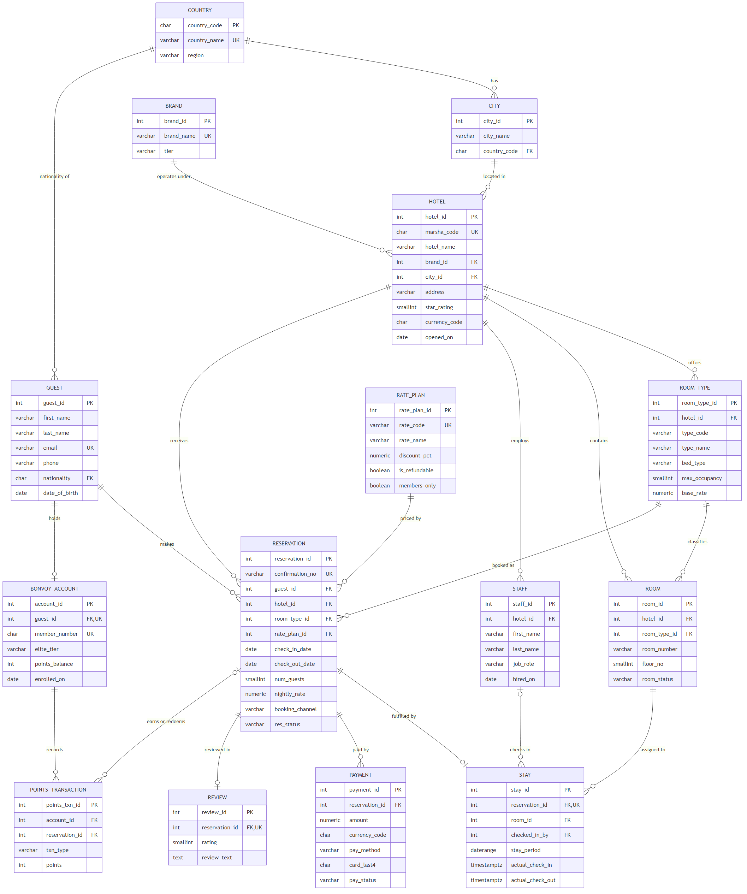
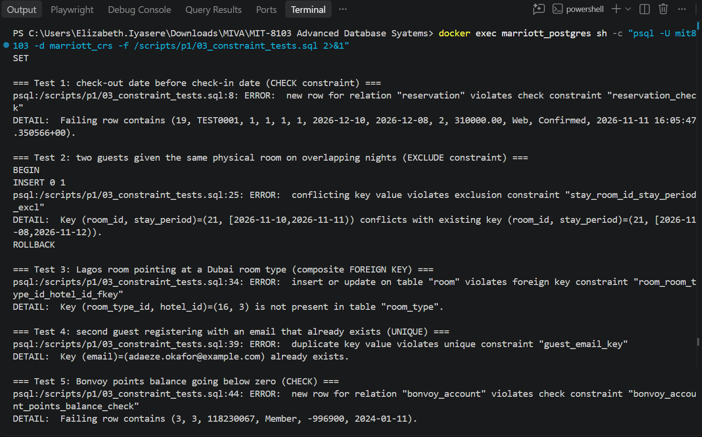
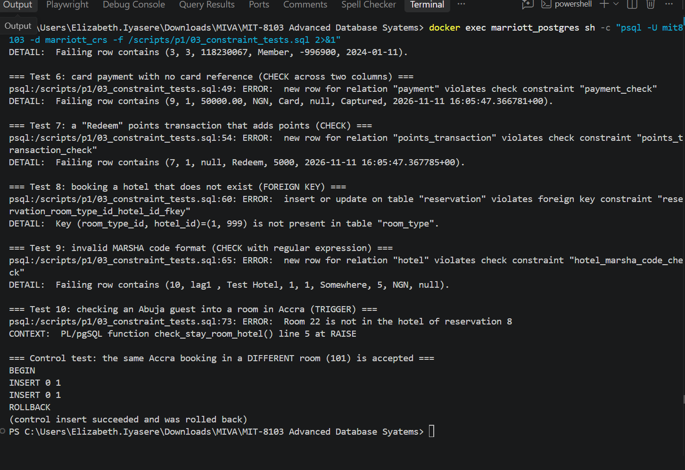

# Portfolio 1: Database Design and Modelling

**Case study:** Marriott International central reservation system and Marriott Bonvoy loyalty database  
**DBMS:** PostgreSQL 16.4 (running in Docker)

## 1. The case study

Marriott sells rooms in more than 9,800 hotels across 145 countries, under over 30 brands. Every
booking, whether it comes from the website, the app, the call centre, a travel agent or someone
walking up to the front desk, has to land in one central system. That system needs to know which
rooms each hotel has, what they cost under each rate plan, who the guest is, whether they are a
Bonvoy member, and whether a room is already taken for the dates asked for.

My database models that core. It covers:

* **Hotels and inventory:** brands, hotels, cities and countries, room types, physical rooms and staff
* **Selling:** rate plans and reservations
* **Operations:** stays (check-in and check-out) and payments
* **Loyalty and feedback:** Bonvoy accounts, points transactions and guest reviews

The sample data uses real Marriott hotels, including four in Nigeria (Lagos Marriott Hotel Ikeja,
Sheraton Lagos, Four Points by Sheraton Lagos and Sheraton Abuja), plus Accra, Dubai, London and
New York. The guests, bookings and prices are made up.

## 2. ER diagram



The source is in [`er_diagram.mmd`](er_diagram.mmd) (Mermaid format, which GitHub also draws on screen).

### Main relationships

| Relationship | Type | Meaning |
|---|---|---|
| Brand to Hotel | 1 to many | Each hotel flies one brand flag, e.g. Sheraton |
| Hotel to Room Type to Room | 1 to many, 1 to many | A hotel defines its room types; each physical room belongs to one type |
| Guest to Reservation | 1 to many | A guest can make many bookings |
| Guest to Bonvoy Account | 1 to 0 or 1 | Not every guest is a member, and nobody can have two accounts |
| Reservation to Stay | 1 to 0 or 1 | A stay only exists once the guest has checked in |
| Reservation to Payment | 1 to many | Deposits, final bills and refunds are separate payments |
| Bonvoy Account to Points Transaction | 1 to many | Every earn, redemption, bonus or expiry is recorded |

### Why a reservation points at a room type and not a room

This was the most important design decision. When you book on marriott.com you choose a
**Deluxe King**, not **room 402**. The hotel only picks the actual room when you arrive. So a
reservation stores `room_type_id`, and the physical `room_id` is stored later in the `stay` table
at check-in. This matches how real hotels work and is also what makes the overbooking problem
in Portfolio 3 possible: the system has to count how many Deluxe King rooms are still free for
the dates asked for, while other guests are booking at the same time.

## 3. Relational schema

Primary keys are **bold**, foreign keys are in *italics*.

* COUNTRY (**country_code**, country_name, region)
* CITY (**city_id**, city_name, *country_code*)
* BRAND (**brand_id**, brand_name, tier)
* HOTEL (**hotel_id**, marsha_code, hotel_name, *brand_id*, *city_id*, address, star_rating, currency_code, opened_on)
* STAFF (**staff_id**, *hotel_id*, first_name, last_name, job_role, hired_on)
* ROOM_TYPE (**room_type_id**, *hotel_id*, type_code, type_name, bed_type, max_occupancy, base_rate)
* ROOM (**room_id**, *hotel_id*, *room_type_id*, room_number, floor_no, room_status)
* RATE_PLAN (**rate_plan_id**, rate_code, rate_name, discount_pct, is_refundable, members_only)
* GUEST (**guest_id**, first_name, last_name, email, phone, *nationality*, date_of_birth, created_at)
* BONVOY_ACCOUNT (**account_id**, *guest_id*, member_number, elite_tier, points_balance, enrolled_on)
* RESERVATION (**reservation_id**, confirmation_no, *guest_id*, *hotel_id*, *room_type_id*, *rate_plan_id*, check_in_date, check_out_date, num_guests, nightly_rate, booking_channel, res_status, booked_at)
* STAY (**stay_id**, *reservation_id*, *room_id*, *checked_in_by*, stay_period, actual_check_in, actual_check_out)
* PAYMENT (**payment_id**, *reservation_id*, amount, currency_code, pay_method, card_last4, pay_status, paid_at)
* POINTS_TRANSACTION (**points_txn_id**, *account_id*, *reservation_id*, txn_type, points, created_at)
* REVIEW (**review_id**, *reservation_id*, rating, review_text, created_at)

The full SQL is in [`01_schema.sql`](01_schema.sql).

## 4. Keys and constraints

I used surrogate keys (auto numbered `SERIAL` columns) as primary keys, because the natural
identifiers can change. A guest can change their email, and a hotel can be rebranded. The
natural identifiers are still protected with `UNIQUE` constraints so they can never be duplicated.

| Rule from the business | How the database enforces it |
|---|---|
| A MARSHA code is exactly 5 capital letters and identifies one hotel | `UNIQUE` plus `CHECK (marsha_code ~ '^[A-Z]{5}$')` |
| A guest can only register once with an email address | `UNIQUE (email)` plus a format `CHECK` |
| A guest can hold at most one Bonvoy account | `UNIQUE (guest_id)` on `bonvoy_account` |
| Room numbers are unique inside a hotel (two hotels can both have a room 101) | `UNIQUE (hotel_id, room_number)` |
| A room can only use a room type from its own hotel | Composite foreign key `(room_type_id, hotel_id)` |
| Check-out must be after check-in | `CHECK (check_out_date > check_in_date)` |
| **One physical room can never hold two guests on the same night** | `EXCLUDE USING gist (room_id WITH =, stay_period WITH &&)` |
| The room given at check-in must be in the booked hotel | Trigger `trg_stay_room_hotel` |
| A points balance can never go below zero | `CHECK (points_balance >= 0)` |
| Redemptions take points away, earnings add them | `CHECK` linking `txn_type` to the sign of `points` |
| A card payment must record the card's last 4 digits, and never the full number | `CHECK (pay_method <> 'Card' OR card_last4 IS NOT NULL)` and a `CHAR(4)` column |
| One review per reservation | `UNIQUE (reservation_id)` on `review` |
| Fixed lists (tiers, statuses, channels, roles) | `CHECK (... IN (...))` |

Two of these go beyond the basics:

* **The exclusion constraint on `stay`.** A normal `UNIQUE` constraint can only spot exact
  duplicates. It cannot tell that 8 to 12 November overlaps 10 to 11 November. PostgreSQL's
  `EXCLUDE` constraint, together with the `daterange` type and the `btree_gist` extension, rejects
  any two stays in the same room whose date ranges overlap.
* **The trigger on `stay`.** A `CHECK` constraint can only look at the row being inserted, so it
  cannot compare the room's hotel with the reservation's hotel. A small PL/pgSQL trigger does that.

### Security decisions, based on the Starwood breach

Attackers were inside the Starwood guest reservation database, which Marriott took over when it
bought Starwood, from 2014 until 2018. They exposed names, contact details and passport numbers,
and the UK Information Commissioner's Office fined Marriott £18.4 million. Two decisions in this
schema come from that case:

1. **No passport numbers are stored.** The central reservation system does not need them, and
   data you do not keep cannot be leaked.
2. **No full card numbers are stored,** only the last four digits, in line with the PCI DSS card
   security standard.

## 5. Normalisation

To show the process, I started from the kind of flat booking sheet a single hotel might keep in
Excel, and normalised it step by step.

**Unnormalised form (UNF).** One row per booking, with repeating groups:

| conf_no | guest_name | guest_email | bonvoy_no | tier | hotel | brand | brand_tier | city | country | room_type | base_rate | check_in | check_out | payments |
|---|---|---|---|---|---|---|---|---|---|---|---|---|---|---|
| 84213097 | Adaeze Okafor | adaeze.okafor@... | 104338271 | Gold Elite | Lagos Marriott Hotel Ikeja | Marriott Hotels | Premium | Lagos | Nigeria | Deluxe King | 310000 | 2026-10-02 | 2026-10-05 | "Card 4417 883500; Card 4417 10000" |

**First normal form (1NF):** every cell must hold one value. The `payments` column holds a list,
so it is moved into its own PAYMENT table with one row per payment. `guest_name` is also split
into `first_name` and `last_name`.

**Second normal form (2NF):** no column may depend on only part of a composite key. In the 1NF
payment table the key would be (conf_no, payment_no), but guest and hotel details depend on
`conf_no` alone. Those columns stay with the booking, and PAYMENT keeps only the payment's own
details. In ROOM_TYPE, which is identified by (hotel, type_code), `base_rate` depends on the
whole key, because a Deluxe King costs different amounts in Lagos and in Dubai, so it stays there.

**Third normal form (3NF):** no non-key column may depend on another non-key column.
The flat sheet has several of these transitive dependencies, and each one became its own table:

| Transitive dependency in the sheet | Problem it causes | Fix |
|---|---|---|
| conf_no → guest_email → guest_name | Guest details repeated on every booking | GUEST table |
| conf_no → bonvoy_no → tier | Tier upgrade must be changed on every old booking | BONVOY_ACCOUNT table |
| conf_no → hotel → brand → brand_tier | Rebranding a hotel means updating thousands of rows | HOTEL and BRAND tables |
| hotel → city → country | Country could be typed differently for the same city | CITY and COUNTRY tables |
| conf_no → room_type → base_rate | Changing a price means updating every booking | ROOM_TYPE table |

**Boyce Codd normal form (BCNF):** every determinant in every table is a candidate key. For
example, in HOTEL both `hotel_id` and `marsha_code` determine all other columns, and both are
keys. In ROOM, `(hotel_id, room_number)` determines everything, and it is declared `UNIQUE`.
I checked each table this way and the final design is in BCNF.

### Columns that look redundant but are kept on purpose

A good design also knows when a repeated value is actually a different fact:

* **`reservation.nightly_rate`** looks like it could be worked out from `room_type.base_rate` and
  `rate_plan.discount_pct`. But base rates change all the time (revenue managers adjust them
  daily). The guest must pay the price they were quoted when they booked, so this is a
  historical fact and must be stored.
* **`payment.currency_code`** is not always the hotel's currency. A Nigerian guest may pay a
  London bill in naira by card.
* **`stay.stay_period`** records the nights the room is actually occupied. It starts the same
  as the booking dates, but changes if a guest leaves early or extends.
* **`bonvoy_account.points_balance`** can be calculated by adding up all of a member's points
  transactions, so storing it is a deliberate **denormalisation**. With millions of members,
  adding up years of transactions every time someone opens the app would be too slow. The
  risk is that the balance and the transactions drift apart. Portfolio 3 handles this by
  updating both inside a single transaction. (In the sample data, balances include points
  earned before the sample period, so they are larger than the listed transactions.)

## 6. How to run and test it

```bash
# from the repository root
docker compose up -d
docker exec marriott_postgres psql -U mit8103 -d marriott_crs -f /scripts/p1/01_schema.sql
docker exec marriott_postgres psql -U mit8103 -d marriott_crs -f /scripts/p1/02_seed_data.sql
docker exec marriott_postgres sh -c "psql -U mit8103 -d marriott_crs -f /scripts/p1/03_constraint_tests.sql 2>&1"   # 2>&1 keeps errors in order
docker exec marriott_postgres psql -U mit8103 -d marriott_crs -f /scripts/p1/04_verify_data.sql
```

| File | Purpose |
|---|---|
| `01_schema.sql` | Creates the `crs` schema: 15 tables, constraints, trigger and indexes |
| `02_seed_data.sql` | Loads 8 hotels, 160 rooms, 12 guests, 14 reservations and related data |
| `03_constraint_tests.sql` | Tries to break 10 business rules on purpose, plus one valid control insert |
| `04_verify_data.sql` | Row counts and joined reports to confirm the data is correct |
| `evidence/` | Saved output from running all of the above |

## 7. Results

All 10 rule breaking inserts were rejected with the expected error, and the valid control insert
was accepted. Full output is in [`evidence/constraint_test_output.txt`](evidence/constraint_test_output.txt). Two examples:

```
=== Test 2: two guests given the same physical room on overlapping nights (EXCLUDE constraint) ===
ERROR:  conflicting key value violates exclusion constraint "stay_room_id_stay_period_excl"
DETAIL:  Key (room_id, stay_period)=(21, [2026-11-10,2026-11-11)) conflicts with existing key (room_id, stay_period)=(21, [2026-11-08,2026-11-12)).

=== Test 10: checking an Abuja guest into a room in Accra (TRIGGER) ===
ERROR:  Room 22 is not in the hotel of reservation 8
```

| Test | Rule | Result |
|---|---|---|
| 1 | Check-out before check-in | Rejected (CHECK) |
| 2 | Same room, overlapping nights | Rejected (EXCLUDE) |
| 3 | Lagos room using a Dubai room type | Rejected (composite FK) |
| 4 | Duplicate guest email | Rejected (UNIQUE) |
| 5 | Negative points balance | Rejected (CHECK) |
| 6 | Card payment without card reference | Rejected (CHECK) |
| 7 | Redemption that adds points | Rejected (CHECK) |
| 8 | Booking at a hotel that does not exist | Rejected (FK) |
| 9 | Badly formatted MARSHA code | Rejected (CHECK) |
| 10 | Room from a different hotel at check-in | Rejected (TRIGGER) |
| Control | Valid stay in a free room | Accepted |

**A problem I found while testing:** my first version of Test 2 reused an Abuja booking to test
a room in Accra. The overlap check fired, but it made me realise nothing stopped a stay from using
a room in a different hotel from its booking. A `CHECK` constraint cannot do this, because it
cannot read another table, so I added the `trg_stay_room_hotel` trigger and Test 10 to prove it.

### Screenshots

Running the tests in my own terminal:



