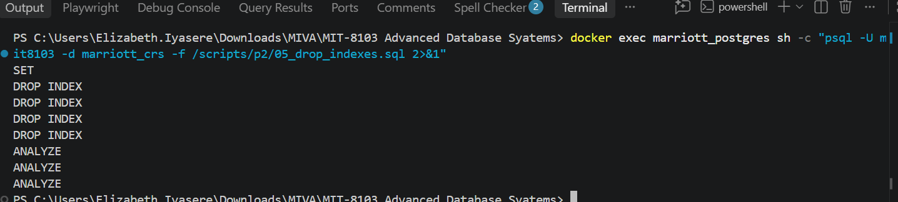
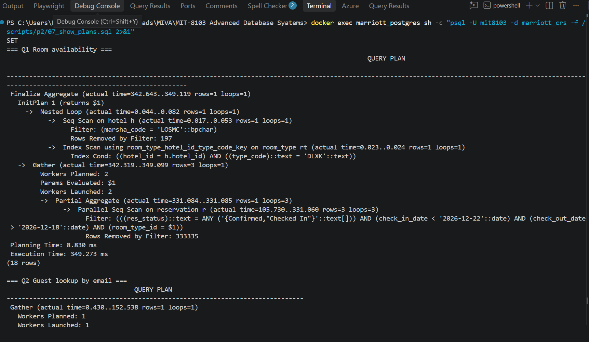
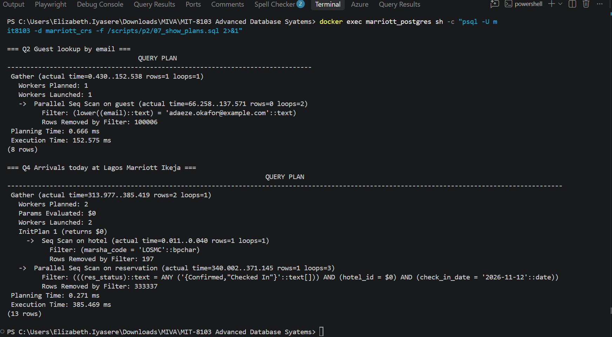
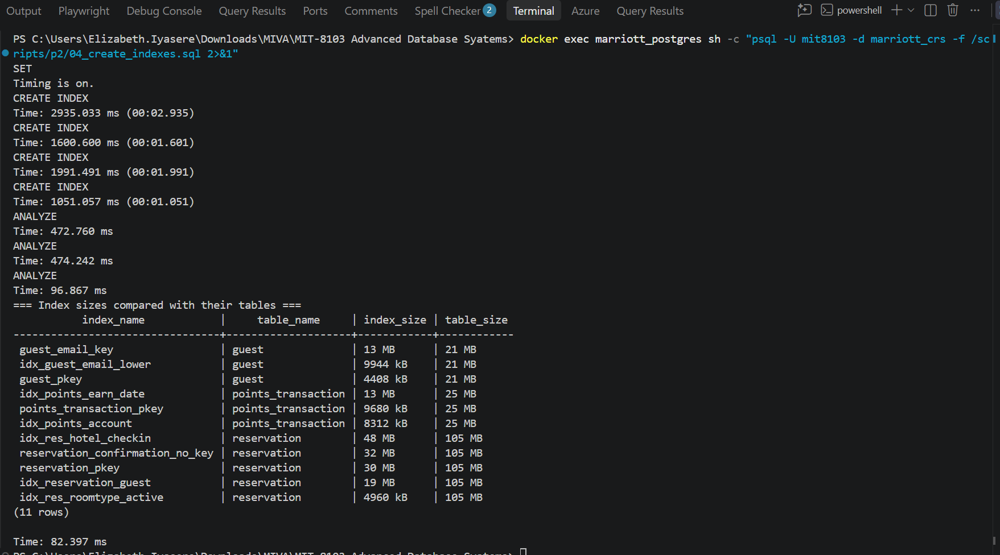
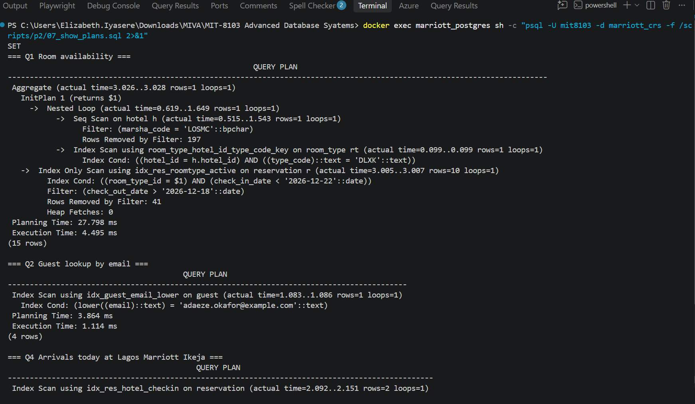
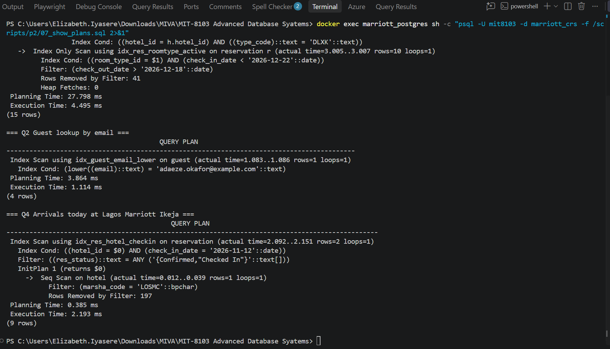
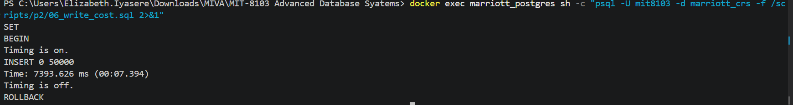

# Portfolio 2: Query Processing and Optimisation

**Case study:** Marriott International central reservation and Bonvoy database (from Portfolio 1)  
**DBMS:** PostgreSQL 16.4 in Docker, on my laptop

## 1. Aim

Marriott's reservation system answers huge numbers of small questions every second: is a room
free, who is arriving today, what is this guest's booking history. In Portfolio 1 the database
only had 14 bookings, so every query was instant and there was nothing to tune. For this
portfolio I generated a realistic volume of data, picked five queries the business actually
runs, measured how PostgreSQL executes them, and then improved them with indexes and rewrites.

## 2. Test data

[`01_generate_data.sql`](01_generate_data.sql) builds on the Portfolio 1 data. It uses a fixed
random seed, so the data comes out the same every time.

| Table | Rows |
|---|---|
| hotel | 198 (in 33 cities, including Lagos, Abuja, Port Harcourt, Accra, Nairobi, Dubai, London, New York) |
| room | 39,959 |
| guest | 200,012 |
| bonvoy_account | 120,127 |
| reservation | 1,000,014 (Jan 2024 to Jun 2027) |
| payment | 716,976 |
| points_transaction | 440,498 |

"Today" is fixed at 12 November 2026, so past bookings are mostly Checked Out, current ones
Checked In and future ones Confirmed, with realistic shares of cancellations and no-shows.

## 3. The five queries

All in [`02_queries.sql`](02_queries.sql). Results are in [`evidence/query_results.txt`](evidence/query_results.txt).

| # | Business question | Who asks it |
|---|---|---|
| Q1 | How many Deluxe King rooms are free at Lagos Marriott Ikeja from 18 to 22 December? | Website, app, call centre (thousands of times a minute) |
| Q2 | Find a guest by email and show their bookings, whatever capitals they type | Call centre, guest login |
| Q3 | Monthly revenue for each Lagos hotel in 2026 | Revenue managers, finance |
| Q4 | Who is arriving at Lagos Marriott Ikeja today? | Front desk, every morning |
| Q5 | Top 10 Bonvoy members by points earned in the last 12 months | Loyalty team |

Q3 and Q5 each have two versions (a and b) because I rewrote them as part of the tuning.

## 4. Method

1. Run the queries once to warm the cache, so every measured run starts with the data in memory.
2. Run each query 5 times with `EXPLAIN (ANALYZE, BUFFERS)` and take the **median** execution
   time ([`benchmark.py`](benchmark.py)). I added this after noticing a single run could vary a
   lot (Q1 took 136 ms on one run and 215 ms on another).
3. Read the plans and find out why each query is slow.
4. Add indexes ([`04_create_indexes.sql`](04_create_indexes.sql)) and rewrite queries where an
   index cannot help.
5. Measure again, and measure what the indexes cost in disk space and insert speed.

## 5. Results

| Query | Before (ms) | After (ms) | Faster by | What changed |
|---|---|---|---|---|
| Q1 Availability | 188.5 | 5.5 | about 34x | Partial index |
| Q2 Email lookup | 72.2 | 0.6 | about 120x | Expression index on `lower(email)` |
| Q3a Revenue, `EXTRACT(YEAR ...)` | 150.3 | 36.3 | about 4x | Composite covering index |
| Q3b Revenue, date range | 95.8 | 15.1 | about 6x | Rewrite plus the same index |
| Q4 Arrivals today | 79.1 | 0.2 | about 400x | Composite index |
| Q5 Top 10 members | 567.1 | 678.6 | no gain | (index added but not useful) |
| Q5b Top 10, rewritten | 162.2 | 150.5 | barely | Rewrite gave the gain, not the index |

Median of 5 runs each. Full numbers: [`evidence/timings_before.md`](evidence/timings_before.md)
and [`evidence/timings_after.md`](evidence/timings_after.md). Full plans:
[`evidence/explain_before.txt`](evidence/explain_before.txt) and
[`evidence/explain_after.txt`](evidence/explain_after.txt).

## 6. What the plans showed, query by query

### Q1 Availability: partial index

**Before:** `Seq Scan on reservation`. PostgreSQL read all 1 million bookings to find the 10
that overlap the dates.

**Fix:**
```sql
CREATE INDEX idx_res_roomtype_active ON reservation (room_type_id, check_in_date)
    INCLUDE (check_out_date)
    WHERE res_status IN ('Confirmed', 'Checked In');
```
Availability only cares about bookings that still hold a room, so this is a **partial index**:
cancelled, no-show and finished stays are left out. It is only **4.9 MB**, compared with 48 MB
for a full index on the same table. `INCLUDE (check_out_date)` puts the other date inside the
index, so the plan became an `Index Only Scan` with `Heap Fetches: 0`. That means the table
itself was never touched.

The query's `WHERE` must match the index's `WHERE` (`res_status IN ('Confirmed', 'Checked In')`)
or PostgreSQL will not use it.

### Q2 Email lookup: expression index

**Before:** `Parallel Seq Scan on guest`, reading all 200,000 guests. There was already a
UNIQUE index on `email` from Portfolio 1, but the query searches `lower(email)`. An index on
`email` cannot be used for `lower(email)`, because they are different values.

**Fix:** `CREATE UNIQUE INDEX idx_guest_email_lower ON guest (lower(email));`

This now uses `Index Scan using idx_guest_email_lower`. Making it UNIQUE also fixes a design
weakness from Portfolio 1: the old constraint would have let `Ada@x.com` and `ada@x.com`
register as two different guests.

### Q3 Revenue: why the rewrite matters

Q3a filters with `EXTRACT(YEAR FROM check_in_date) = 2026`. Q3b uses
`check_in_date >= '2026-01-01' AND check_in_date < '2027-01-01'`. The answers are identical.

**Before any index**, both were full scans, but the plans already showed a difference:

| | Planner estimated rows | Actual rows |
|---|---|---|
| Q3a (`EXTRACT`) | 1,517 | 73,418 |
| Q3b (range) | 87,528 | 73,418 |

Wrapping the column in a function hides it from PostgreSQL's statistics, so it guessed 50 times
too low. Bad estimates lead to bad plan choices, such as picking a nested loop that would be
very slow for 73,000 rows.

**Fix:** a composite **covering** index:
```sql
CREATE INDEX idx_res_hotel_checkin ON reservation (hotel_id, check_in_date)
    INCLUDE (check_out_date, nightly_rate, res_status);
```
Both versions now use it, because `hotel_id` is the first column. But only Q3b can use the
date part of the index to jump to 2026. Q3a has to read every Lagos booking for all years and
then throw most of them away. That is why Q3b (15.1 ms) is still more than twice as fast as
Q3a (36.3 ms) with the same index.

### Q4 Arrivals: the same index, reused

**Before:** a full scan of 1 million rows to find 2 arrivals. The index above has `hotel_id`
then `check_in_date`, which is exactly what this query filters on, so one index serves both Q3
and Q4. Q4 went from 79 ms to 0.2 ms.

Column order matters. An index on `(check_in_date, hotel_id)` would also work for Q4, but not
for Q3, which asks for one hotel over a whole year.

### Q5 Top members: when an index is not the answer

**Before:** 567 ms. The plan showed `Sort Method: external merge Disk: 4680kB` twice. The
query grouped about 85,000 members by number, name and tier, and sorted them on disk, only to
keep 10.

I first tried an index (`idx_points_earn_date`, covering, partial on `txn_type = 'Earn'`).
PostgreSQL did use it (`Index Only Scan`), but the time did not improve, because a third of
the table matches and the cost is in adding up and sorting, not in finding rows.

**Fix:** rewrite the query (Q5b):
1. Add up points per `account_id` only (a narrow, cheap grouping)
2. `ORDER BY points_earned DESC FETCH FIRST 10 ROWS WITH TIES`, which keeps anyone tied with
   10th place, the same as `RANK() <= 10`
3. Only then join to `bonvoy_account` and `guest` for those 10 people

My first rewrite used `RANK()` in a subquery and was still slow (408 ms). The plan showed the
planner expected 83,000 rows out of the ranking, so it hashed the whole guest table for the
join. `FETCH FIRST ... WITH TIES` tells the planner only about 10 rows come out, so it switched
to a `Nested Loop` with index lookups. Q5b gives exactly the same top 10 as Q5 and is about
3.5 times faster, with or without the index.

## 7. What the indexes cost

Indexes are not free. Every new booking now has to update the indexes too, and they take disk space.

| Index | Size | Table size |
|---|---|---|
| idx_res_hotel_checkin | 48 MB | reservation 105 MB |
| idx_res_roomtype_active (partial) | 4.9 MB | reservation 105 MB |
| idx_guest_email_lower | 9.9 MB | guest 21 MB |
| idx_points_earn_date | 13 MB | points_transaction 25 MB |

**Insert speed** ([`06_write_cost.sql`](06_write_cost.sql), [`evidence/write_cost.md`](evidence/write_cost.md)):
inserting 50,000 bookings took a median of **1,743 ms without** the new indexes and
**2,182 ms with** them, about **25% slower**. For Marriott that is an easy trade: guests search
far more often than they book, and the slowdown is a fraction of a millisecond per booking.

## 8. What I would keep in production

| Index | Keep? | Reason |
|---|---|---|
| idx_res_roomtype_active | Yes | Small, and it serves the most frequent query in the business |
| idx_guest_email_lower | Yes | Fast lookups, and it fixes the case-sensitivity gap in Portfolio 1 |
| idx_res_hotel_checkin | Yes | One index serves both reporting (Q3) and the front desk (Q4) |
| idx_points_earn_date | **No** | 13 MB plus write cost for almost no gain. The rewrite fixed Q5 instead. |
| guest_email_key (from P1) | Could be dropped | `idx_guest_email_lower` is stricter, so the old UNIQUE index is now redundant (13 MB) |

## 9. Other observations

* **Parallel workers.** Before indexing, PostgreSQL split the big scans across 2 or 3 processes
  (`Workers Launched`). After indexing, the plans are so cheap that it does not bother.
* **Overbooking in the data.** Q1 returned 10 bookings for only 8 Deluxe King rooms. The
  generator inserts bookings without checking availability, which is exactly what happens when
  two booking requests check availability at the same moment and both succeed. Portfolio 3
  tackles this problem.
* **Limits of this test.** It ran on a laptop in Docker, with all data in memory. On a real
  server with cold disks, the gap between full scans and index scans would be even larger.

## 10. How to run it

```bash
# from the repository root, with the Portfolio 1 scripts already run
docker exec marriott_postgres sh -c "psql -U mit8103 -d marriott_crs -f /scripts/p2/01_generate_data.sql 2>&1"   # about 5 minutes
docker exec marriott_postgres sh -c "psql -U mit8103 -d marriott_crs -f /scripts/p2/02_queries.sql 2>&1"
python portfolio-2-query-optimisation/benchmark.py before
docker exec marriott_postgres sh -c "psql -U mit8103 -d marriott_crs -f /scripts/p2/04_create_indexes.sql 2>&1"
python portfolio-2-query-optimisation/benchmark.py after
docker exec marriott_postgres sh -c "psql -U mit8103 -d marriott_crs -f /scripts/p2/06_write_cost.sql 2>&1"
# 05_drop_indexes.sql puts the database back to the "before" state
```

| File | Purpose |
|---|---|
| `01_generate_data.sql` | Generates 1 million bookings and related data |
| `02_queries.sql` | The five business queries (plus rewritten Q3b and Q5b) |
| `03_explain.sql` | The same queries with `EXPLAIN (ANALYZE, BUFFERS)` |
| `04_create_indexes.sql` | Creates the four indexes and lists their sizes |
| `05_drop_indexes.sql` | Removes them again |
| `06_write_cost.sql` | Times 50,000 inserts, then rolls back |
| `benchmark.py` | Runs `03_explain.sql` 5 times and records median times |
| `evidence/` | All saved output |

## 11. Screenshots

These are single runs from my own terminal. Single runs vary (especially the first run after
indexes are dropped or created, when the data is not yet cached), which is why the results
table in section 5 uses the median of 5 runs instead.

**Removing the Portfolio 2 indexes to get the "before" state**



**Before indexing:** `Parallel Seq Scan on reservation` and `Parallel Seq Scan on guest`, with
hundreds of thousands of rows removed by the filter




**Creating the indexes**, with their sizes



**After indexing:** `Index Only Scan` with `Heap Fetches: 0` for Q1, and index scans for Q2 and Q4




**Insert cost test:** 50,000 bookings inserted, then rolled back. This single run took 7.4
seconds because it ran straight after the indexes were rebuilt. The median over 4 runs was
2.2 seconds (see section 7).



The timing tables are in [`evidence/timings_before.md`](evidence/timings_before.md) and
[`evidence/timings_after.md`](evidence/timings_after.md).
