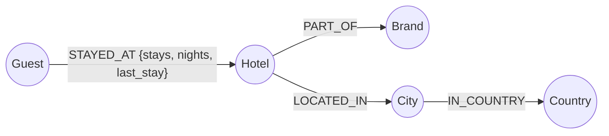

# Portfolio 4: NoSQL and Advanced Data Models

**Case study:** Marriott International central reservation and Bonvoy database  
**DBMS:** MongoDB 7.0.14 (document and key-value) and Neo4j 5.26 Community (graph), both in Docker,
loaded from the PostgreSQL database built in Portfolios 1 and 2

## 1. Why NoSQL for Marriott

In 2015 Marriott's central reservation system, Marsha, was handling about 38 billion dollars of
bookings a year on a single mainframe with 160 GB of memory. Mainframe skills were hard to find,
changes were expensive, and the company wanted to compete better online. Marriott chose
Couchbase, a NoSQL document database, to start moving the system off the mainframe. The reasons
it gave were the built-in cache, sharding, being able to add servers easily, and replication
between data centres, all without giving up uptime. The first rollout held 13 million documents
at 200 transactions per second, with a plan for 30 million documents at 4,000 per second
(Reed, 2015).

That raises the question for this portfolio: which parts of the Marriott data fit a NoSQL model
better than the relational one, and which do not. I used the same data as Portfolios 1 to 3
(198 hotels, 200,014 guests, 1,000,018 bookings) in three NoSQL models:

| Model | Where | Used for |
|---|---|---|
| Document | MongoDB: `hotels`, `guests`, `reservations` | Screens that show one thing with everything that belongs to it |
| Key-value | MongoDB: `availability` | "Is there a room on this night?", the most frequent question in the system |
| Graph | Neo4j: guests, hotels, cities, countries, brands | "Guests who stayed here also stayed at", recommendations, link analysis |

## 2. Loading the same data

[`load_mongo.py`](load_mongo.py) runs three SQL files in [`export/`](export/) that make
PostgreSQL build each document as one line of JSON, and streams them straight into
`mongoimport`. Nothing large is written to disk. Dates are written as `$date` and money as
`$numberDecimal`, so MongoDB stores real dates and exact decimals, not text or floating point.

| Collection | Documents | Average size | On disk (compressed) | Load time |
|---|---|---|---|---|
| hotels | 198 | 701 bytes | under 1 MB | 3 s |
| guests | 200,014 | 709 bytes | 47 MB | 42 s |
| reservations | 1,000,018 | 576 bytes | 191 MB | 112 s |

The counts match PostgreSQL exactly, and all 716,976 payments ended up inside their bookings
([`evidence/load_mongo.txt`](evidence/load_mongo.txt)).

For the graph, [`export/graph_csv.sql`](export/graph_csv.sql) writes CSV files that
[`06_load_graph.cypher`](06_load_graph.cypher) loads into Neo4j in 93 seconds.

## 3. Document model

### Embed or reference?

The main design decision in a document database is what goes inside a document and what is
kept separate. My rule was: embed what is always read together and belongs to only one parent;
reference what is shared or grows without limit.

| Data | Decision | Reason |
|---|---|---|
| Room types in a hotel | Embedded in `hotels` | A hotel has 3 to 5 room types, always shown with the hotel |
| Bonvoy account | Embedded in `guests` | One account per guest, read on every profile screen |
| Guest's bookings | Last 3 embedded in `guests`, full history in `reservations` | A frequent guest could have hundreds; a document must stay small (MongoDB's limit is 16 MB) |
| Payments and points for a booking | Embedded in `reservations` | They belong to that one booking and are always shown with it |
| Guest, hotel and room type in a booking | A small copy of the fields the booking screen needs | Avoids a lookup on every read; the full records stay in their own collections |

The copies are deliberate duplication. The guest's name in a booking is a snapshot from when
they booked; if they change their name later, old bookings keep the old one, which is what a
hotel invoice should show anyway. This is the same trade-off as the deliberate denormalisation
in Portfolio 1 (`points_balance`, `nightly_rate`), but much more of it.

A booking document ([`export/reservations.sql`](export/reservations.sql)):

```json
{
  "_id": "90485359",
  "guest": { "id": 63464, "name": "Layla Chen", "member_number": "200063464", "tier": "Silver Elite" },
  "hotel": { "code": "QAAAC", "name": "Marriott Hotels Abu Dhabi Downtown", "city": "Abu Dhabi", "brand": "Marriott Hotels" },
  "room_type": { "code": "EXSU", "name": "Executive Suite" },
  "rate_plan": "FLEX",
  "check_in": { "$date": "2026-08-10T00:00:00Z" },
  "check_out": { "$date": "2026-08-13T00:00:00Z" },
  "nights": 3,
  "guests": 1,
  "nightly_rate": { "$numberDecimal": "1196.99" },
  "currency": "AED",
  "channel": "Call Centre",
  "status": "Checked Out",
  "booked_at": { "$date": "2026-07-11T20:11:39Z" },
  "payments": [ { "amount": { "$numberDecimal": "3590.97" }, "currency": "AED", "method": "Cash",
                  "status": "Captured", "paid_at": { "$date": "2026-08-13T10:30:00Z" } } ],
  "points": [ { "type": "Earn", "points": 2976, "at": { "$date": "2026-08-14T02:00:00Z" } } ]
}
```

In PostgreSQL the same booking is spread over seven tables: reservation, guest,
bonvoy_account, hotel, room_type, payment and points_transaction.

### Flexible schema, with rules where they matter

Different brands offer different things: a Ritz-Carlton has butler service, a Residence Inn has
kitchens in the rooms, and the Nigerian hotels list their backup power. In a relational table
each of these would be a mostly empty column or a separate table. In MongoDB each hotel just has
the fields that apply to it (the feature values are sample data):

```
LOSFP  Select        {"backup_power":"24 hour generator and inverter","airport_shuttle":true,"grab_and_go_market":true}
LOSMC  Premium       {"club_lounge":true,"backup_power":"24 hour generator and inverter","meeting_rooms":7,"airport_shuttle":true}
QAACX  Extended Stay {"backup_power":"24 hour generator and inverter","pet_friendly":false,"weekly_rates":true,"airport_shuttle":true,"kitchen_in_room":true}
```

Flexible does not have to mean anything goes. [`01_create_collections.js`](01_create_collections.js)
adds a `$jsonSchema` validator to each collection for the fields every document must have.
A booking with 0 nights and the status "Pending" was rejected, while a booking with a brand new
`special_requests` field was accepted ([`evidence/document_queries.txt`](evidence/document_queries.txt)):

```
rejected: nights, status broke the rules
accepted: P4NEW1 with a new field (special_requests) that no other booking has
```

### Queries

[`04_document_queries.js`](04_document_queries.js), with the indexes from
[`02_create_indexes.js`](02_create_indexes.js):

| Query | Plan | Keys / documents examined |
|---|---|---|
| Guest profile by email (profile, Bonvoy account, recent bookings) | IXSCAN on `email_1` | 1 / 1 |
| Full booking history for that guest, newest first | IXSCAN on `guest.id_1_check_in_-1`, no sort step | 17 / 17 |
| Room nights by brand for the last 12 months | Aggregation pipeline: `$match`, `$group`, `$sort` | whole collection |
| Add a payment to a booking | One `$push` on one document | 1 |

The last one matters. Adding a payment changes one document, and MongoDB always changes a
single document atomically, so the booking and its payments can never get out of step. In
PostgreSQL the same thing needs a transaction across two tables (Portfolio 3).

The brand query reports room nights, not revenue. The hotels charge in 18 different currencies,
so adding the money up across brands would be meaningless without exchange rates.

## 4. The same screens in PostgreSQL and MongoDB

[`compare.py`](compare.py) runs each screen hundreds of times inside its own container
(pgbench for PostgreSQL, a loop in mongosh for MongoDB), so both have the same network path
([`evidence/compare.md`](evidence/compare.md)):

| Screen | PostgreSQL (ms) | PostgreSQL + index on points.reservation_id (ms) | MongoDB (ms) |
|---|---|---|---|
| Empty query (`SELECT 1` / `ping`): client and round trip only | 0.215 | 0.110 | 1.900 |
| Guest profile screen (profile, Bonvoy, 3 recent bookings) | 0.867 | 0.832 | 2.766 |
| Booking detail screen (booking, guest, hotel, room, payments, points) | 21.818 | 0.842 | 2.496 |
| Room nights by brand, last 12 months (analytics) | 47.277 | 47.225 | 621.600 |

What I learned from this, which was not what I expected:

- **For one-record screens, both are under a millisecond of real work.** The empty `ping` shows
  that mongosh itself adds about 1.9 ms to every call. Take that away and MongoDB's profile and
  booking reads take about 0.6 to 0.9 ms, the same as PostgreSQL.
- **The booking screen exposed a missing index in my relational design.** PostgreSQL took 22 ms
  because `points_transaction` had no index on `reservation_id`, so it scanned all 440,498
  points rows. With the index it drops to 0.8 ms. The document model never had this problem,
  because the points are inside the booking. A relational design needs an index on every
  foreign key that a screen joins on; a document design has fewer joins to forget.
- **For analytics, PostgreSQL is far ahead.** The brand report scans a year of bookings.
  PostgreSQL does it in 47 ms; MongoDB takes 620 ms, because its aggregation has to read and
  decode every full booking document, including the embedded payments and points it does not need.

So the document model is not faster in general. It is simpler for screens that show one thing,
and weaker for reports across many things.

## 5. Key-value: room availability

Searching is far more common than booking, so "is there an Executive Suite at Lagos Marriott
Ikeja on 24 December?" should not mean counting bookings every time. In
[`05_availability_kv.js`](05_availability_kv.js) each hotel, room type and night is one key:

```
LOSMC|EXSU|2027-12-24  total 4  sold 3  free 1
```

The check is a single key lookup (plan `IDHACK`, 1 key and 1 document examined), and a
key-value store like this is easy to cache and to spread across servers, the same features
Marriott gave for choosing Couchbase.

A booking takes each night with one atomic update that only succeeds while there is space
([`kv_book.js`](kv_book.js)):

```js
avail.updateOne({ _id: key, $expr: { $lt: ["$sold", "$total"] } }, { $inc: { sold: 1 } })
```

[`race_availability.py`](race_availability.py) sends 10 guests for the last suite at the same
moment, first with "read the count, then write" and then with the atomic update
([`evidence/race_availability.txt`](evidence/race_availability.txt)):

| Method | Guests told "booked" | Suites sold |
|---|---|---|
| Read, then write | 8 | 11 of 4 |
| Atomic conditional update | 1 | 4 of 4 |

The number of overbookings with read-then-write changes from run to run (I saw between 2 and 8),
but it was never zero. The atomic version gave exactly one booking every time. This is the same
problem as the overbooking in Portfolio 3; the fix there was a lock, and here it is putting the
check and the change into one operation.

### No transaction across nights

A 3 night stay needs 3 keys. On a single MongoDB server there is no transaction across several
documents (that needs a replica set, which Portfolio 5 sets up), so if the third night is full,
the first two have already been taken. My booking function gives them back:

```
A stay of 22 to 26 Dec: the first two nights are free, the 24th is full
{ ok: false, full_night: 'LOSMC|EXSU|2027-12-24', given_back: 2 }
```

For a moment, those two nights looked sold when they were not. This is the BASE approach that
Study Session Two contrasts with ACID: the data is "eventually" right rather than right at
every instant. For an availability count that is acceptable, because the booking itself is
still confirmed in the relational system. For money or points it would not be.

## 6. Graph model

Study Session Five describes graph databases as nodes, relationships (edges) and properties,
where relationships are stored directly instead of being worked out through joins at query
time. That makes them good for questions that follow connections, such as recommendations and
fraud detection, and it names Neo4j and its Cypher language as the most widely used example.



| Nodes | Count | Relationships | Count |
|---|---|---|---|
| Guest | 200,014 | STAYED_AT | 721,238 |
| Hotel | 198 | PART_OF | 198 |
| City | 33 | LOCATED_IN | 198 |
| Country | 21 | IN_COUNTRY | 33 |
| Brand | 8 | | |

`STAYED_AT` is built from completed stays only, one relationship per guest and hotel, with the
number of stays and nights as properties.

### Queries

[`07_graph_queries.cypher`](07_graph_queries.cypher)
([`evidence/graph_queries.txt`](evidence/graph_queries.txt)):

**1. Guests who stayed at Lagos Marriott Hotel Ikeja also stayed at**

```cypher
MATCH (:Hotel {code: 'LOSMC'})<-[:STAYED_AT]-(g:Guest)-[:STAYED_AT]->(other:Hotel)
RETURN other.code AS hotel, other.name AS name, count(DISTINCT g) AS shared_guests
ORDER BY shared_guests DESC LIMIT 5;
```

| Hotel | Shared guests |
|---|---|
| Residence Inn London Waterfront | 90 |
| Courtyard Abuja Business District | 86 |
| Westin Singapore Central | 85 |
| JW Marriott Singapore North | 83 |
| Four Points New York City Centre | 82 |

**2. Cities that share the most guests with Lagos:** New York (12,288), London (11,555),
Dubai (10,088), Paris (7,173), Abuja (5,971). A marketing team could use this to choose which
routes to promote to Lagos guests.

**3. Recommendations for one guest:** find the 50 guests whose stays overlap most with
Layla Chen's, then the hotels they went to that she has not. Top result: Westin Johannesburg
Central.

**4. How two guests are connected** (the kind of check a fraud team does on a suspected
points-pooling ring):

```
Layla Chen (63464) -> Westin Chicago Central -> Sophie Silva (142924) -> Four Points by Sheraton Lagos -> Omar Muller (89631)
```

**5. Elite members who have stayed in the most countries:** three hops from guest to hotel to
city to country. Top: Sophie Musa, Platinum Elite, 11 countries.

My first version of query 5 said the top member had stayed in 21 countries, which was
impossible, because nobody in the data has more than 17 bookings. I had grouped by the guest's
name, and 900 names in the data belong to more than one guest, so different people were added
together. Grouping by the guest's ID fixed it. A name is not an identifier, in a graph just as
in a table.

### The same questions in SQL

[`graph_compare.py`](graph_compare.py) runs queries 1 and 3 in both databases
([`evidence/graph_compare.md`](evidence/graph_compare.md)); the SQL versions are in
[`compare/`](compare/):

| Question | PostgreSQL (ms) | Neo4j (ms) |
|---|---|---|
| Guests who stayed at LOSMC also stayed at | 138 | 39 |
| Hotel recommendations for one guest | 243 | 71 |

Neo4j was about 3.5 times faster on both, and the queries are much shorter. The SQL for
query 1 joins the reservation table to itself and needs a `GROUP BY` and `DISTINCT`; the
recommendation needs two CTEs. In Cypher both are one pattern that reads like the question.
The shortest path (query 4) would need a recursive CTE in SQL, which I did not attempt, while
in Cypher it is one line.

## 7. Which model suits which job

| Job | Best fit | Why |
|---|---|---|
| Making a booking, taking payment, moving points | Relational (PostgreSQL) | Needs ACID transactions across several records and strict constraints (Portfolios 1 and 3) |
| Guest profile, booking detail, hotel page in the app | Document (MongoDB) | One read returns the whole screen; brands can have their own fields |
| Availability during search | Key-value | Read far more often than written; one key lookup; atomic counters |
| Recommendations, travel patterns, fraud links | Graph (Neo4j) | Questions about connections, many hops deep |
| Reports across many bookings | Relational, or a data warehouse | PostgreSQL was 13 times faster than MongoDB on the brand report |

My recommendation for Marriott is to use more than one model: keep the booking and loyalty
records in a system of record with full ACID transactions, and copy data out to NoSQL stores
shaped for the questions they answer. The cost is keeping the copies up to date. In this portfolio the
copies were made once by a script; in production they would be fed by change events from the
relational database, and the NoSQL copies would always be slightly behind, which is the
trade-off of the BASE model.

## 8. Summary

| What I tested | Result |
|---|---|
| Load 1.2 million rows into documents | Counts match exactly; 238 MB compressed in MongoDB |
| Validation in a schemaless store | Bad booking rejected; new optional field accepted |
| One-record screens, MongoDB vs PostgreSQL | About the same once client overhead is removed |
| Booking detail screen in PostgreSQL | 22 ms because of a missing foreign key index; 0.8 ms with it |
| Analytics, MongoDB vs PostgreSQL | PostgreSQL 13 times faster |
| 10 guests, last suite, read then write | Overbooked (8 bookings for 1 suite in the saved run) |
| 10 guests, last suite, atomic update | Exactly 1 booking |
| Multi-night stay hitting a full night | Nights already taken were given back |
| Graph queries vs SQL | Neo4j about 3.5 times faster, and much shorter queries |

## 9. How to run it

```bash
# from the repository root, with Portfolios 1 and 2 already loaded in PostgreSQL
docker compose up -d
cd portfolio-4-nosql

python load_mongo.py                                                         # about 3 minutes
docker exec marriott_mongo mongosh --quiet /scripts/p4/04_document_queries.js
python compare.py
docker exec marriott_mongo mongosh --quiet /scripts/p4/05_availability_kv.js
python race_availability.py

docker exec marriott_postgres sh -c "psql -U mit8103 -d marriott_crs -f /scripts/p4/export/graph_csv.sql 2>&1"
docker exec marriott_neo4j cypher-shell -u neo4j -p mit8103_pass -f /scripts/p4/06_load_graph.cypher
docker exec marriott_neo4j cypher-shell -u neo4j -p mit8103_pass --format verbose -f /scripts/p4/07_graph_queries.cypher
python graph_compare.py
```

The Neo4j browser is at http://127.0.0.1:7474 (user `neo4j`, password `mit8103_pass`).

## References

- MIVA Open University (2025) *MIT 8103 Advanced Database Systems*. Course material, Study Session Two (ACID and BASE) and Study Session Five (graph databases, 5.2.1).
- MongoDB, Inc. (2024) *Data Modeling: Embedded Data versus References*. Available at: https://www.mongodb.com/docs/manual/data-modeling/concepts/embedding-vs-references/
- MongoDB, Inc. (2024) *Schema Validation*. Available at: https://www.mongodb.com/docs/manual/core/schema-validation/
- Neo4j, Inc. (2024) *Cypher Manual*. Available at: https://neo4j.com/docs/cypher-manual/current/
- Reed, J. (2015) *Why Marriott is transforming their legacy systems with NoSQL*. diginomica. Available at: https://diginomica.com/why-marriott-is-transforming-their-legacy-systems-with-nosql
