# Portfolio 5: Distributed and Cloud Databases

**Case study:** Marriott International central reservation and Bonvoy database  
**DBMS:** MongoDB 7.0.14 in Docker (a 3-node replica set, and a sharded cluster with 2 regional
shards), and MongoDB Atlas 8.0 on the free M0 tier (AWS, Paris)

## 1. Why Marriott's data has to be distributed

Marriott sells rooms in about 9,800 hotels in 145 countries from one shared inventory. A guest in
Lagos, a travel agent in London and the hotel's own front desk can all be booking the same
Executive Suite at the same moment. For years that inventory lived in Marsha, a single mainframe
system (Portfolio 4). In 2021 Marriott agreed to replace it with Amadeus's cloud based central
reservation system (Amadeus, 2021), and by September 2025 its new cloud reservation, property and
loyalty systems were being trialled at six hotels, with a phased rollout planned over 18 months
(Hotel Technology News, 2025).

A system like that has to keep working when a server fails, has to stay fast for guests far from
the data centre, and cannot let the copies disagree about whether a room is sold. This portfolio
tests those three things on the Marriott data:

| Question | How I tested it | Section |
|---|---|---|
| What happens to the copies of the data when they are on several servers? | 3-node replica set: lag, write concern, stale reads | 3 |
| What happens to bookings when a server dies or is cut off? | Killed the primary, then cut it off the network, while bookings were being saved | 4 |
| Can a multi-night stay now be all or nothing? | Multi-document transactions on the replica set | 5 |
| Can each region's bookings live in its own data centre? | Sharded by region, with zones | 6 |
| What does a managed cloud database change? | Same data and tests on MongoDB Atlas | 7 |

## 2. Set-up

Portfolio 5 has its own [`docker-compose.yml`](docker-compose.yml) with two profiles, so only one
cluster runs at a time:

| Profile | Containers | Used for |
|---|---|---|
| `replica` | `p5_rs1`, `p5_rs2`, `p5_rs3` (replica set `rs0`) | Sections 3, 4, 5 and the local side of 7 |
| `sharded` | `p5_cfg` (config server), `p5_shard_emea`, `p5_shard_amer`, `p5_mongos` (router) | Section 6 |

Each node gets a 0.25 GB cache. My laptop ran out of memory once with everything up (Docker
Desktop froze and had to be restarted), so I stopped the Portfolio 1 to 4 containers while doing
this portfolio and only ran one profile at a time.

[`copy_data.py`](copy_data.py) copies the data from the Portfolio 4 MongoDB. For bookings it only
takes the upcoming ones (check-in from 12 November 2026), because that is the live data a
reservation system has to keep available everywhere; past stays belong in a reporting database
([`evidence/copy_data.txt`](evidence/copy_data.txt)):

| Collection | Documents |
|---|---|
| hotels | 198 |
| guests | 200,014 |
| availability | 36 |
| reservations (upcoming) | 180,417 |

## 3. Replication and consistency

Study Session Two describes two ways to place data on several sites: fragmentation, where each
site holds a part, and replication, where each site holds a copy. A MongoDB replica set is full
replication. One node is the primary and takes all the writes; the others are secondaries that
copy the primary's log of changes (the oplog) and apply it after it has happened. That makes it
asynchronous replication, so a secondary is always slightly behind.

[`02_replication_consistency.js`](02_replication_consistency.js) measures this. To make a
secondary fall behind on purpose, it uses a MongoDB test switch (the `rsSyncApplyStop` fail
point) that pauses replication on one node. That switch only works because the nodes start with
`enableTestCommands`, which is for testing only
([`evidence/replication_consistency.txt`](evidence/replication_consistency.txt)):

| Test | Result |
|---|---|
| Every node holds a full copy | 180,417 bookings and 200,014 guests on rs1, rs2 and rs3 |
| Time for a write to be visible on a secondary (20 writes) | median 14 ms, slowest 173 ms |
| Write acknowledged by 1 node (`w: 1`) vs a majority (`w: "majority"`), 200 inserts | 8.17 ms vs 15.99 ms each |
| Guest cancels a booking; replication paused on rs1 | primary: Cancelled, rs3: Cancelled, **rs1: Confirmed (stale)** |
| Both secondaries paused, write with `w: "majority"` | `WriteConcernFailed` after 3 s |
| Both secondaries paused, write with `w: 1` | acknowledged in 19 ms, but only the primary has it |
| Replication resumed | all three nodes agree again after 712 ms |

The stale read is the reason this matters. If a hotel's front desk read from rs1, it would see a
cancelled booking as still confirmed, and could turn away a guest for a room that is free.

The two failed writes show what write concern really means. With `w: "majority"` the app was told
the write had not been confirmed, so it could tell the guest to try again. With `w: 1` the guest
would have been told "booked" while only one server had the booking; if that server died before
replicating it, the booking would be lost even though the guest has a confirmation. For bookings
and payments I would always use `w: "majority"`. It roughly doubled the time per write here,
from 8 to 16 ms, which a guest would never notice.

### Read your own writes

Between strong and eventual consistency there are models such as causal consistency and
read-your-writes, and MongoDB offers them through causally consistent sessions. In the last test a guest adds "airport pickup" to a booking, and the next read goes to
the lagging rs1:

```
read on lagging rs1 without the session: special_request = undefined   <- stale
read on lagging rs1 with the session: waited 2 s and gave up (MaxTimeMSExpired) rather than return old data
after it catches up (with session):    special_request = airport pickup
```

Without the session, the guest would think the request was lost and probably submit it again.
With the session, rs1 refuses to answer until it has caught up with the guest's own write. It
would rather be slow, or fail, than be wrong.

## 4. Failover and network partitions

[`failover_test.py`](failover_test.py) runs a stand-in for the booking app
([`booking_writer.js`](booking_writer.js)) in its own container. It saves a booking every 200 ms
with `w: "majority"` while the script breaks the primary. Every timestamp in the output comes from
the writer's clock, and each one is when that attempt started, so a booking that had to wait for
a new primary shows the time it began waiting.

### Test 1: the primary is killed

([`evidence/failover.txt`](evidence/failover.txt))

```
16:08:58.765 booking  11 saved   (primary rs2)
16:08:58.979 booking  12 FAILED  Error
16:08:59.346 booking  13 FAILED  MongoServerSelectionError
>>> 16:08:59.692 killed the primary: rs2
16:09:01.553 booking  14 FAILED  MongoServerSelectionError
16:09:03.759 booking  15 FAILED  MongoServerSelectionError
16:09:05.966 booking  16 FAILED  MongoServerSelectionError
16:09:08.168 booking  17 saved   (primary rs1)
...
    16:09:09.386 rs1: Starting an election, since we've seen no PRIMARY in election timeout period
    16:09:09.399 rs1: Election succeeded, assuming primary role
    16:09:09.727 rs1: Transition to primary complete; database writes are now permitted
```

Bookings 12 and 13 fail before the "killed" line because the script prints that line after
`docker kill` returns. The remaining nodes waited for MongoDB's election timeout (10 seconds by
default) before deciding rs2 was gone, then elected rs1 in 13 ms. Booking 17 started at 08.168,
waited for the new primary and was saved once writes were allowed at 09.727. In total, writes
stopped for about 11 seconds, 5 bookings failed, and 124 were saved. No booking that was
acknowledged was lost. When rs2 came back it rejoined as a secondary and copied what it had
missed.

Five failed attempts in 10 seconds is fine for a test. For Marriott it would mean every guest
trying to book anywhere in the world in those seconds gets an error, so the app would have to
retry, and the election timeout is a trade-off: shorter means faster failover but more false
alarms on a slow network.

### Test 2: the primary is cut off from the network

Here rs2 keeps running but is disconnected from the others, which is what a network partition
looks like ([`evidence/partition.txt`](evidence/partition.txt)):

```
>>> 23:30:28.006 cut the primary off the network: rs2
23:30:34.441 booking  13 FAILED  MongoServerSelectionError
...
    23:30:37.485 rs2: Stepping down from primary in response to heartbeat
    23:30:38.410 rs1: Starting an election, since we've seen no PRIMARY in election timeout period
    23:30:38.433 rs1: Election succeeded, assuming primary role
    23:30:44.452 rs1: Transition to primary complete; database writes are now permitted
>>> 23:30:44.310 the cut-off node rs2 says: stepped down, not accepting writes
```

The important line is rs2 stepping down. It was still running and could have kept accepting
bookings from any app that could reach it. Instead, once it could no longer see a majority, it
stopped being primary. The two nodes that could see each other (rs1 and rs3) elected a new
primary. This time writes stopped for about 17 seconds, longer than with the crash. rs1 won the
election about 10 seconds after the cut, as before, but writes were only allowed 6 seconds after
that. The writer also lost time: after booking 12 failed, the next attempt hung for almost 7
seconds on a connection to rs2 that never answered. That is why
[`booking_writer.js`](booking_writer.js) sets `socketTimeoutMS`: packets to a cut-off server are
dropped, not refused, and without a timeout the app would wait forever.

### What this shows about CAP

Study Session Two explains the CAP theorem: during a network partition a distributed database has
to choose between consistency (every read sees the latest write) and availability (every request
gets an answer). The partition test shows how a replica set makes that choice. A primary needs
to reach a majority of the nodes, so rs2, cut off on its own, stepped down and refused writes,
while rs1 and rs3 still formed a majority and elected a new primary. With `w: "majority"` writes,
the replica set kept the data consistent by giving up write availability on the minority side.
For about 17 seconds nobody could book, rather than two primaries accepting bookings for the same
last suite and disagreeing later. It is not a complete loss of availability: the majority side
recovered, and an app that asks for secondary reads could still read from rs2, but those reads
could be stale, as section 3 showed.

For room inventory that is the right choice. Two data centres both selling the last suite would
mean a guest arriving to no room, which is the overbooking problem from Portfolio 3 on a global
scale. The cost is a short outage during a partition, which the app has to handle with retries
and a clear message.

## 5. Transactions across documents

In Portfolio 4, a 3-night stay had to take each night separately from the availability keys and
give nights back if a later one was full, because a single MongoDB server has no transactions
across documents. On a replica set it does.
[`03_transactions.js`](03_transactions.js) books the nights and saves the booking in one
transaction, with snapshot reads and `w: "majority"`
([`evidence/transactions.txt`](evidence/transactions.txt)):

| Test | Result |
|---|---|
| 2 suites free on all three nights | committed: each night goes from 2/4 to 3/4 sold, 1 booking saved |
| The last night (26 Dec) is full | aborted: the 24th and 25th were taken inside the transaction, but the abort undid them; nothing changed |
| Two guests, one suite left, both in transactions at once | B gets `WriteConflict` (a `TransientTransactionError`) as soon as it touches the night A has taken; A commits; B retries and finds the suite gone |

The third test shows that MongoDB transactions are optimistic. B did not wait for a lock as the
`SELECT ... FOR UPDATE` version in Portfolio 3 did; it was stopped straight away and told to try
again. The result is the same, exactly one booking for the last suite, and this closes the gap
I left in Portfolio 4: the stay is now all or nothing (ACID) instead of being fixed up afterwards
(BASE).

## 6. Sharding bookings by region

Sharding is horizontal fragmentation: the rows of one collection are split across servers. Study
Session Two uses splitting by region as its example of horizontal fragmentation, and it fits
Marriott, where a booking at a Lagos hotel is almost always read by that hotel, its guests, and
regional teams.

[`shard_setup.py`](shard_setup.py) and [`04_shard_config.js`](04_shard_config.js) build a cluster
with two shards standing for two groups of data centres, and use zones to pin each region to one
shard:

| Shard | Zone | Regions |
|---|---|---|
| `emea` | EMEA | Africa, Europe, Middle East |
| `amer` | AMER_APAC | US & Canada, Caribbean & Latin America, Asia Pacific |

The shard key is `{ region, _id }`. Starting with the region keeps each region's bookings
together on its own shard, and adding `_id` makes every key unique, so a busy region can still be
split into smaller chunks later. The upcoming bookings loaded through the router (`mongos`) in 68
seconds ([`evidence/shard_setup.txt`](evidence/shard_setup.txt)).

### Which queries touch which shard

[`05_shard_queries.js`](05_shard_queries.js)
([`evidence/shard_queries.txt`](evidence/shard_queries.txt)):

```
shard emea: 111994 bookings   (Africa 50108, Europe 40065, Middle East 21821)
shard amer:  68423 bookings   (Asia Pacific 17269, Caribbean & Latin America 5629, US & Canada 45525)
```

| Query: arrivals at Lagos hotels on 24 Dec 2026 | Shards asked | Documents examined | Time |
|---|---|---|---|
| With the region, no extra index | emea only (`SINGLE_SHARD`) | 50,108 | 93 ms |
| Without the region, no extra index | both (`SHARD_MERGE`) | 180,417 | 104 ms |
| With the region, index on `{ region, hotel.city, check_in }` | emea only | **68** | **9 ms** |
| Without the region, same index | both | 180,417 | 102 ms |

I expected the targeted query to be much faster on its own, and it was not. Without an index,
asking one shard meant that shard scanned every African booking by itself, while the
scatter-gather query split a bigger scan across two shards working at the same time. In my
screenshot run the targeted query was even slower (100 ms against 55 ms). Sending a query to the
right shard only pays off when that shard can also find the rows quickly. With the index, the
targeted query examined 68 documents instead of 180,417 and took 9 ms.

The last row is just as important. Without the region in the query, even the index did not help,
because the index starts with `region`. So the shard key is not only about where data lives. It
decides which questions are cheap, and an app built on this design must always include the
region, which for a hotel booking it always knows.

A report across all regions still works: each shard counts its own bookings and `mongos` merges
the results, so Africa (50,108 bookings, 150,000 nights) and the US & Canada (45,525 bookings)
appear in one answer.

## 7. Moving to a cloud database: MongoDB Atlas

Study Session Three lists the main features of cloud databases: scalability, high availability,
managed services, elasticity and global access. To see what that means in practice I created a
free M0 cluster on MongoDB Atlas, which is MongoDB's own database service on public cloud
infrastructure. The cluster, `MIT8103`, runs MongoDB 8.0.37 as a 3-node replica set on AWS in
Paris (eu-west-3). Atlas built and runs the replica set I set up by hand in sections 2 and 3, so
failover, patching and monitoring are its job.

### Copying the data

[`copy_to_atlas.py`](copy_to_atlas.py) streams `mongodump` from the local cluster straight into
`mongorestore` on Atlas. The connection string and password are in a file that git ignores; the
script reads it inside a throwaway container, so it never appears in the output, on the command
line or in the repository ([`evidence/copy_to_atlas.txt`](evidence/copy_to_atlas.txt)):

| Collection | Documents | On disk in Atlas | Copy time |
|---|---|---|---|
| reservations (upcoming) | 180,417 | 26.9 MB | 591 s |
| guests | 200,014 | 50.0 MB | 815 s |
| hotels | 198 | 0.1 MB | 5 s |
| availability | 36 | under 0.1 MB | 4 s |

The whole database takes about 83 MB, well inside the free tier's 512 MB. The copy was slow
because every batch crossed the internet: 180,417 bookings took almost 10 minutes to Atlas,
against 68 seconds into the local sharded cluster.

Two things went wrong, and both taught me something:

- **A copy that reported success but was incomplete.** My laptop's public IP address changed
  while guests were copying. Atlas only accepts connections from addresses on its access list, so
  the connection dropped at 184,902 of 200,014 guests, yet `mongorestore` still exited with code
  0. I only noticed because I checked the counts. The script now reads `mongorestore`'s own
  summary and stops if any document failed, instead of trusting the exit code.
- **Indexes that did not come across.** I copied the bookings from the sharded cluster, which only
  had the shard key index. The first Atlas test showed the arrivals query examining 180,510
  documents to find 1 booking, taking 110 ms on the server
  ([`evidence/cloud_latency_before_index.txt`](evidence/cloud_latency_before_index.txt)). The
  script now creates the Portfolio 4 booking indexes after copying, and the same query examines 1
  document. A migration has to move the indexes as well as the data, and nothing warns you
  when they are missing.

### Local against cloud

[`06_cloud_latency.js`](06_cloud_latency.js) runs the same operations 30 times each on both
systems, after a warm-up, and [`cloud_latency.py`](cloud_latency.py) runs it on both one after
the other ([`evidence/cloud_latency.txt`](evidence/cloud_latency.txt)). Times are medians in ms:

| Operation | Local replica set | Atlas (Paris) |
|---|---|---|
| `ping` (network round trip only) | 3 | 133 |
| Guest profile by email | 3 | 135 |
| Guest's bookings, newest first | 3 | 140 |
| Arrivals at Lagos Marriott Ikeja on one day | 2 | 136 |
| Insert booking, `w: 1` | 4 | 139 |
| Insert booking, `w: "majority"` | 7 | 136 |
| 3-night booking in one transaction | 24 | 904 |
| Report: bookings and nights per region | 110 | 288 |

What the numbers show:

- **In the cloud, the time is the distance, not the database.** The arrivals query took 0 ms on
  the Atlas server itself; the other 136 ms was the trip to Paris and back. Every single read or
  write cost one round trip, about 135 ms.
- **The transaction cost about 6 round trips** (3 nights, the booking, the commit, and the test's
  own undo step), so it took 904 ms. An app that talks to its database many times per request
  multiplies the distance. For a far-away database it is better to make fewer, larger calls, or
  to keep the database close to the people using it.
- **`w: "majority"` cost nothing extra on Atlas.** Locally it took 7 ms against 4 ms; on Atlas
  both were about 136 ms. The three Atlas nodes are all in the Paris region, so waiting for a
  second copy adds very little compared with the internet round trip.
- **The report was faster than its round trip suggests.** It took 288 ms on Atlas against 110 ms
  locally, so the Atlas server did the aggregation in roughly 150 ms. The free tier runs on shared
  hardware, so this is not a fair test of server speed, only of what a free cluster gives.

This links the cloud back to sharding. If Lagos bookings are served from Paris, every guest and
front desk in Nigeria pays more than 130 ms for every call. Atlas lets a cluster be sharded
across regions with zones, as in section 6, so a Marriott deployment could keep EMEA bookings in
a European or African region and Americas bookings in the US.

### What the cloud service gave and what it did not

| Cloud database feature | What I saw |
|---|---|
| High availability | A 3-node replica set across availability zones from the start, with no set-up |
| Managed services | No servers, no Docker, no `rs.initiate`; version 8.0.37, newer than my local 7.0.14 |
| Global access | Reachable from anywhere, but only from approved IP addresses, as I found out |
| Scalability and elasticity | Not on the free tier: M0 has a fixed 512 MB on shared hardware; scaling up or sharding needs a paid cluster |
| Monitoring | Built-in charts of reads, writes, connections and network traffic |

Backups were shown as "Inactive" on the free tier. For a reservation system, that alone would
rule M0 out. It is for learning, and a production system needs a paid tier with backups and
point-in-time restore.

## 8. Recommendation for Marriott

| Need | Design | Evidence |
|---|---|---|
| A server failure must not lose bookings | Replica set with at least 3 nodes, `w: "majority"` for bookings, payments and points | Section 3: `w: 1` can confirm a booking only one server has |
| No double-selling during a network fault | Accept a short pause (CP) rather than two primaries (AP) for inventory | Section 4: the cut-off primary stepped down |
| Guests see their own changes | Causally consistent sessions for anything a guest edits | Section 3: without one, the special request vanished |
| Multi-night stays and loyalty points are all or nothing | Multi-document transactions on the replica set, with retry on `TransientTransactionError` | Section 5 |
| Regional data stays close to its hotels | Shard by `{ region, _id }` with zones, index starting with the region, region always in the query | Section 6 |
| Speed for guests far from the data | Data in regions near the hotels, fewer calls per request | Section 7: about 135 ms per round trip to Paris |
| Searches that do not need the latest second | Availability and search screens can read from nearby secondaries and accept slightly stale data | Section 3: secondaries were usually under 15 ms behind |

The trade-off underneath all of these is the CAP trade-off from section 4: strong consistency
costs speed and, during failures, availability. The design above pays that cost only where a wrong
answer means a guest without a room or a wrong points balance, and relaxes it for searching and
browsing, where seeing a slightly old answer does no harm.

## 9. Summary

| What I tested | Result |
|---|---|
| Replication lag | median 14 ms, slowest 173 ms |
| `w: 1` vs `w: "majority"` | 8 vs 16 ms locally; about the same on Atlas |
| Read from a lagging secondary | Cancelled booking shown as Confirmed |
| Majority write with both secondaries down | `WriteConcernFailed`, so no false confirmation |
| Causally consistent session | Refused to return stale data |
| Primary killed | Writes back after about 11 s, 5 failed bookings, none lost |
| Primary cut off by a partition | Stepped down; majority elected a new primary (CP) |
| Multi-night stay in a transaction | All or nothing; second guest got `WriteConflict` |
| Sharding by region | Targeted query with index: 68 documents and 9 ms vs 180,417 and 102 ms |
| Atlas copy | Incomplete copy reported as success; indexes missing; both caught and fixed |
| Local vs Atlas | About 135 ms per call to Paris; server time close to 0 ms |

## 10. How to run it

```bash
cd portfolio-5-distributed-cloud

# replica set
docker compose --profile replica up -d
docker exec p5_rs1 mongosh --quiet /scripts/p5/01_init_replica_set.js
python copy_data.py                     # needs marriott_mongo from Portfolio 4 running
docker exec p5_rs1 mongosh --quiet /scripts/p5/02_replication_consistency.js
python failover_test.py failover
python failover_test.py partition
docker exec p5_rs1 mongosh --quiet /scripts/p5/03_transactions.js

# Atlas: put the connection details in atlas-credentials.env (MONGODB_URI=...), git ignores it
python copy_to_atlas.py hotels guests availability
python cloud_latency.py both
docker compose --profile replica stop

# sharded cluster
docker compose --profile sharded up -d
python shard_setup.py
docker exec p5_mongos mongosh --quiet /scripts/p5/05_shard_queries.js
python copy_to_atlas.py reservations    # copies the bookings from mongos
```

## References

- Amadeus (2021) *Amadeus Announces Agreement with Marriott International to Deploy Transformative, Cloud-based CRS Solution*. Available at: https://amadeus.com/en/newsroom/press-releases/marriott-international-to-deploy-transformative-crs-solution
- Hotel Technology News (2025) *Marriott Bets on Cloud-Native Platforms, AI Agents and Unified Guest Data to Power Smarter Hotel Operations*. Available at: https://hoteltechnologynews.com/2025/09/marriott-bets-on-cloud-native-platforms-ai-agents-and-unified-guest-data-to-power-smarter-hotel-operations/
- MIVA Open University (2025) *MIT 8103 Advanced Database Systems*. Course material, Study Session Two (fragmentation, replication, consistency models, CAP theorem, ACID and BASE) and Study Session Three (cloud database systems).
- MongoDB, Inc. (2024) *Replication*. Available at: https://www.mongodb.com/docs/manual/replication/
- MongoDB, Inc. (2024) *Causal Consistency and Read and Write Concerns*. Available at: https://www.mongodb.com/docs/manual/core/causal-consistency-read-write-concerns/
- MongoDB, Inc. (2024) *Zones*. Available at: https://www.mongodb.com/docs/manual/core/zone-sharding/

## Screenshots

These are my own runs. Timings change from run to run, so some differ from the saved evidence
files, but the outcomes are the same every time.

**Replication and consistency:** in this run replication was faster than in the saved evidence
(median 5 ms, `w: 1` 3.13 ms against `w: "majority"` 7.50 ms, catch-up in 65 ms); the stale read,
the `WriteConcernFailed` and the session refusing to return old data are the same

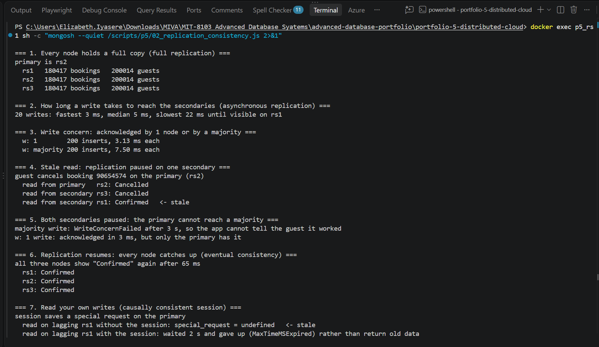

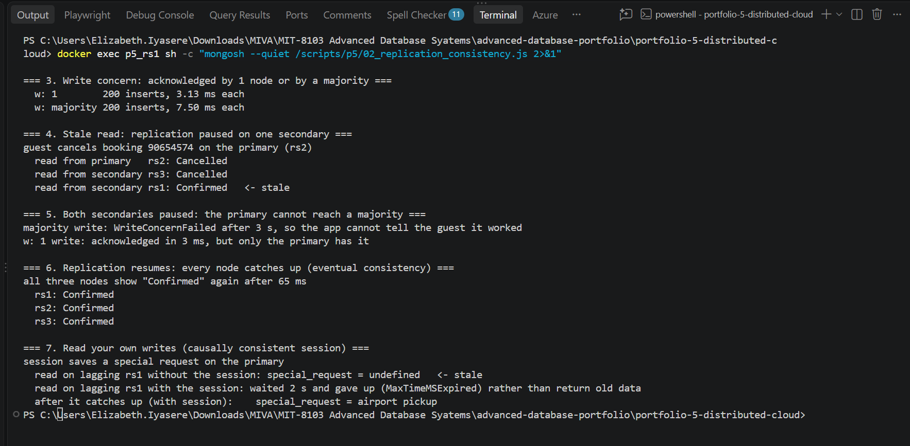

**Failover:** bookings are saved on rs2, fail while it is down, then continue on rs1

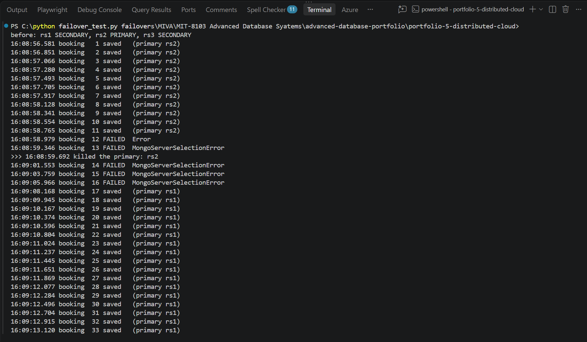

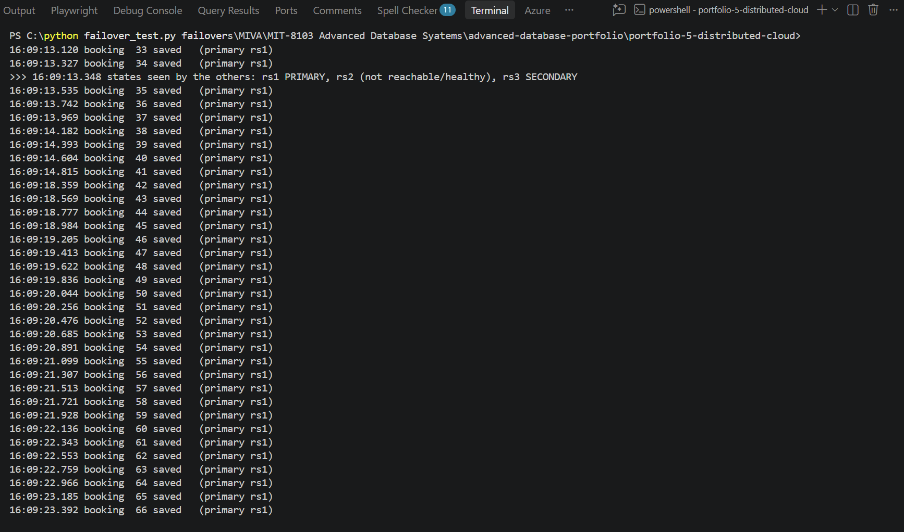

**Failover, the end:** rs2 rejoins as a secondary, and rs1's log shows the election

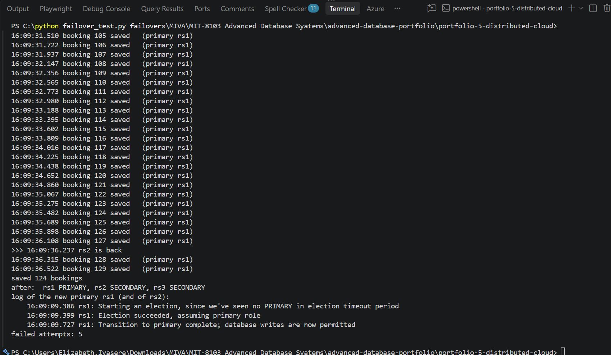

**Multi-night booking in one transaction:** commit, abort with nothing changed, and `WriteConflict`
for the second guest

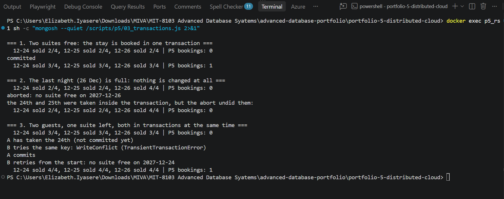

**Sharding by region:** in this run the targeted query without an index took 100 ms against
55 ms for scatter-gather; with the index it examined 68 documents in 3 ms

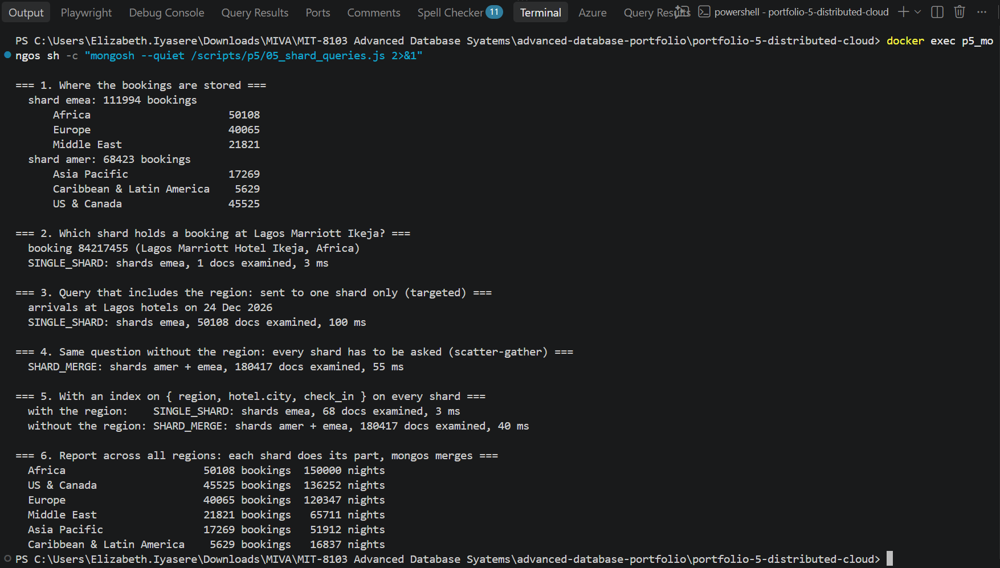

**The Atlas cluster:** MongoDB 8.0.37, AWS Paris (eu-west-3), replica set with 3 nodes

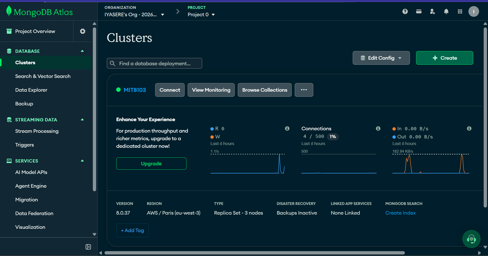

**The Marriott data in Atlas**

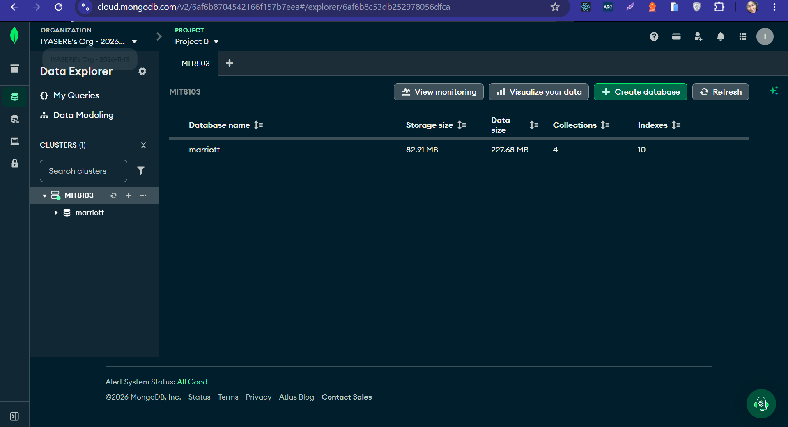

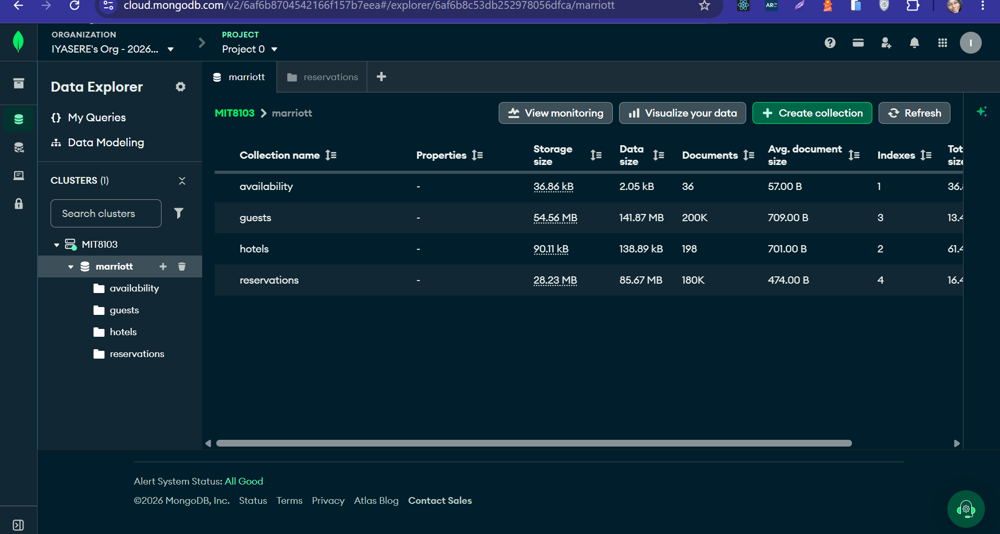

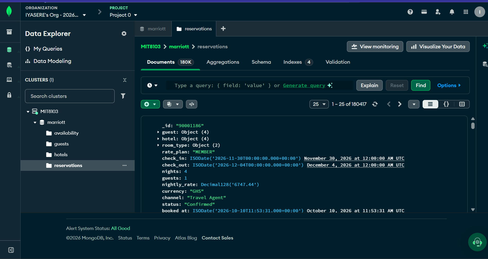

**Local against Atlas:** the run saved in the evidence file

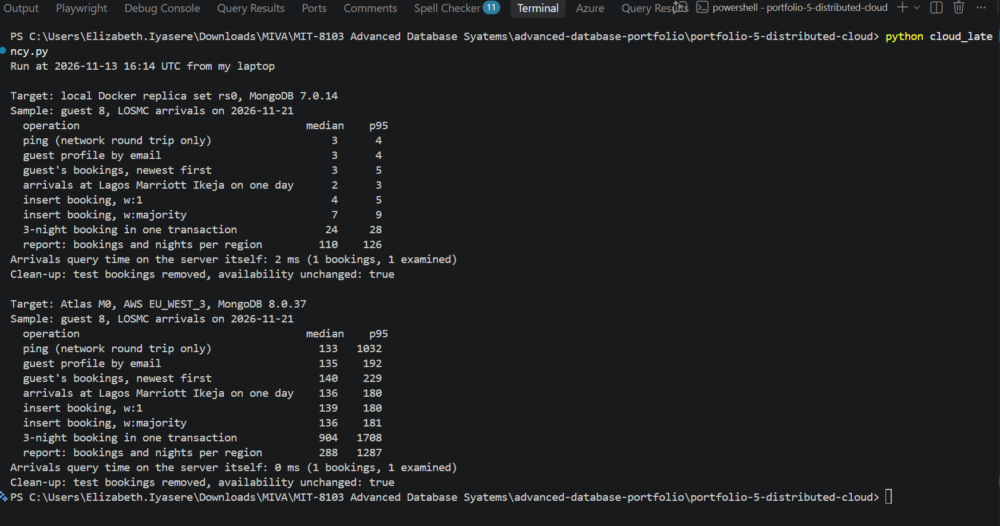
